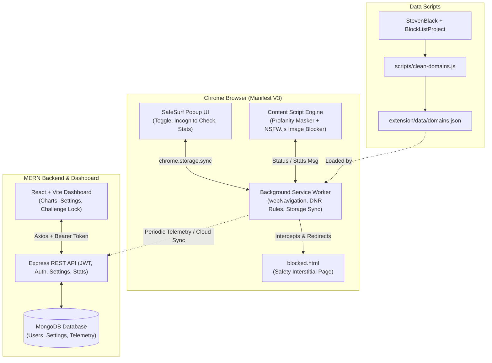

# SafeSurf - Project Master Plan & Architecture

SafeSurf is an intelligent, multi-layer content protection suite consisting of:
1. **Manifest V3 Chrome Extension**: Real-time adult domain blocking, SafeSearch enforcement, AI-driven on-device NSFW image blurring, profanity masking, and incognito enforcement.
2. **Data Pipeline & Domain Cleaners**: High-performance Node.js list-processing engine consolidating multiple threat-intelligence feeds into an optimized domain database.
3. **MERN Backend Server**: Node.js, Express, MongoDB (Mongoose), JWT authentication, user settings sync, and telemetry aggregation.
4. **React Admin/User Dashboard**: React 18+ (Vite), Tailwind CSS, Recharts analytics, whitelist/blacklist configuration, and security delay challenges.

---

## 1. System Architecture



---

## 2. Project Directory Structure

```text
SafeNest/
├── extension/                      # Chrome Extension (Manifest V3)
│   ├── manifest.json               # MV3 Extension Manifest
│   ├── background.js               # Service Worker: Navigation & DNR manager
│   ├── content.js                  # Content script: DOM profanity & image processor
│   ├── content.css                 # Content script styles for blurring & tooltips
│   ├── blocked.html                # High-aesthetic block interstitial page
│   ├── blocked.css                 # Interstitial styling
│   ├── blocked.js                  # Interstitial logic (safety quotes, return back)
│   ├── popup/
│   │   ├── popup.html              # Extension action popup
│   │   ├── popup.css               # Glassmorphism dark-mode UI
│   │   └── popup.js                # State toggle, incognito detector & guide
│   ├── icons/                      # Extension icons (16, 32, 48, 128)
│   ├── models/                     # Bundled NSFW.js model weights (CSP-compliant)
│   └── data/
│       ├── domains.json            # Processed blocked domains database
│       └── profanity/
│           ├── en.json             # English profanity dictionary
│           └── indic.json          # Hindi / Tamil / Tanglish profanity dictionary
├── scripts/                        # Node.js data pipeline
│   ├── clean-domains.js            # Fetch, dedupe, normalize porn hosts
│   └── validate-lists.js           # Verification and benchmark script
├── server/                         # MERN Backend API
│   ├── config/                     # DB connection & environment config
│   ├── middleware/                 # JWT authentication, error handling, rate limit
│   ├── models/                     # Mongoose schemas: User, Settings, BlockStats
│   ├── routes/                     # Auth, settings, telemetry stats routes
│   ├── index.js                    # Express application entry point
│   ├── package.json
│   └── .env.example
├── dashboard/                      # React Admin & Analytics Dashboard
│   ├── src/
│   │   ├── components/             # Reusable UI components (Navbar, StatsCard, etc.)
│   │   ├── pages/                  # Login, Register, Dashboard, Settings, Challenge
│   │   ├── services/               # Axios API client
│   │   ├── App.jsx
│   │   └── main.jsx
│   ├── index.html
│   ├── vite.config.js
│   ├── tailwind.config.js
│   └── package.json
├── PLAN.md                         # Architecture and execution plan
└── .gitignore                      # Git ignore file
```

---

## 3. Implementation Phases

### Phase 1: Extension Skeleton & Core State Management (CURRENT)
- **Deliverables**:
  - `manifest.json` configured for MV3 with proper permissions (`storage`, `webNavigation`, `declarativeNetRequest`, `tabs`).
  - `popup/` featuring a modern, dark-mode glassmorphism interface:
    - Master Protection ON/OFF toggle.
    - Synchronized persistence using `chrome.storage.sync`.
    - Real-time Incognito status detection using `chrome.extension.isAllowedIncognitoAccess()`.
    - Setup modal / direct action guide with fallback handling for Chrome URL navigation restrictions.
  - `blocked.html`: Branded, responsive blocked interstitial page.
  - Extension icon set (16x16, 32x32, 48x48, 128x128).
  - Background service worker skeleton with badge updates and storage listeners.
- **Verification**: Load unpacked extension in `chrome://extensions`, verify popup toggle saves state across reopens, test incognito detection in normal vs incognito windows, test navigation to `blocked.html`.

### Phase 2: High-Performance Domain Blocking
- **Deliverables**:
  - `scripts/clean-domains.js`: Fetches StevenBlack porn hosts and Block List Project `porn.txt`, removes loopback IPs and comments, strips wildcards, canonicalizes hostnames, and outputs compact `extension/data/domains.json`.
  - Service worker fast-lookup engine: Loads domain set into an in-memory `Set` on worker activation.
  - Interception on `chrome.webNavigation.onBeforeNavigate`: Checks hostname & parent domain suffixes against blocked set, whitelist, and custom blacklist.
  - Redirects matched requests to `chrome-extension://<id>/blocked.html?url=<encodedUrl>`.
- **Verification**: Run list generation script, inspect output size and accuracy, test navigation to flagged domains and ensure instant redirection; verify whitelisted domains pass through.

### Phase 3: DOM Text & Profanity Masking Engine
- **Deliverables**:
  - `content.js` text scanning engine using `TreeWalker` to target visible text nodes without corrupting script/style tags or form inputs.
  - Curated profanity dictionaries (`en.json` + `indic.json` for Hindi/Tamil/Tanglish).
  - Regex-based boundary matching with memoization and debounced `MutationObserver` for single-page applications (YouTube, Twitter/X, Reddit).
  - Smooth replacement with asterisks (`***`).
- **Verification**: Open test HTML page and social media feeds, check dynamically inserted comments, verify profane strings are masked within milliseconds without UI lag.

### Phase 4: On-Device AI Image Classifier (NSFW.js)
- **Deliverables**:
  - Locally bundled NSFW.js and TensorFlow.js model files inside `extension/models/` to strictly comply with MV3 CSP (no external script loading).
  - IntersectionObserver to scan only visible/near-viewport images (``, `background-image`, `<picture>`).
  - Pre-filter: Skip icons, avatars, images < 100x100px.
  - Classification: If `Porn` or `Hentai` or `Sexy` exceeds configurable threshold, apply CSS blur filter (`filter: blur(28px)`) with warning tag.
  - Anti-bypass click prevention: Reveal disabled while master protection is ON.
- **Verification**: Run against test image pages with explicit vs safe imagery; verify high detection accuracy, zero network leakage of images, and strict lock against clicking to unblur.

### Phase 5: Enforced SafeSearch on Search Engines
- **Deliverables**:
  - `declarativeNetRequest` dynamic rule sets to inject SafeSearch parameters:
    - Google: Append `safe=active`.
    - Bing: Append `adlt=strict`.
    - DuckDuckGo: Append `kp=1`.
    - YouTube: Inject `PREF=f2=8000000` header / query or redirect to enforce Restricted Mode.
  - Rules dynamically toggled in background worker when protection state changes.
- **Verification**: Perform searches on Google, Bing, DuckDuckGo, and YouTube; confirm search engines permanently reflect strict filtering in UI and URL parameters.

### Phase 6: MERN Backend API
- **Deliverables**:
  - Express server with modular architecture: `models/`, `routes/`, `middleware/`, `config/`.
  - MongoDB models: `User` (email, hashed password, createdDate), `Settings` (userId, enabled, whitelist, blacklist, sensitivity), `BlockStats` (userId, date, blockedSites, maskedWords, blurredImages).
  - Routes: `POST /api/auth/register`, `POST /api/auth/login`, `GET/PUT /api/settings`, `POST /api/stats`, `GET /api/stats/weekly`.
  - Security: JWT auth middleware, bcrypt hashing (12 rounds), CORS, helmet, express-validator, rate-limiting.
  - `.env` configuration template.
- **Verification**: Automated test suite / curl requests testing registration, JWT token generation, settings persistence, and analytics retrieval.

### Phase 7: React Dashboard & Security Challenge
- **Deliverables**:
  - React + Vite dashboard styled with Tailwind CSS.
  - Authentication flow: Login, Register, Protected Routes.
  - Live analytics charts (weekly blocked sites, masked words, blurred images) with Recharts.
  - Whitelist and blacklist rule manager.
  - Delay & Challenge Lock: Optional feature where disabling SafeSurf requires a 60-second cooldown timer plus a randomized verification typing challenge (e.g. typing an anti-addiction pledge) to prevent impulsive relapses.
- **Verification**: End-to-end integration test connecting the dashboard to backend and verifying user login, setting toggling, challenge lock countdown, and telemetry visualizations.

---

## 4. MV3 Constraints & Technical Mitigations

| Challenge | MV3 Limitation | SafeSurf Mitigation |
| :--- | :--- | :--- |
| **Service Worker Inactivity** | Worker terminates after ~30s of idle time; global variables are discarded. | All state (`enabled`, `whitelist`, `blacklist`) persisted in `chrome.storage.sync`. Fast reload on `onStartup` and `onInstalled`. Worker wakes up transparently on `webNavigation.onBeforeNavigate`. |
| **Static DNR Rule Limits** | DeclarativeNetRequest limits static rules (~300k total, 30k regex). Large blocklists (>50k domains) exceed dynamic limits. | Combine DNR for SafeSearch header rewrites with in-worker `webNavigation.onBeforeNavigate` checking against an optimized memory `Set` for domain interception. |
| **Strict Content Security Policy (CSP)** | MV3 strictly disallows `eval()`, `new Function()`, and loading external scripts (`cdn.jsdelivr...`). | Bundle NSFW.js and TensorFlow.js weights directly inside the extension package (`web_accessible_resources`). |
| **Restricted `chrome://` Navigation** | Extensions cannot open `chrome://extensions` directly via `chrome.tabs.create` due to browser security restrictions. | The popup catches navigation rejections, provides automatic one-click clipboard copying of the setup URL, and renders a step-by-step visual onboarding guide. |
| **Incognito Permissions** | Extensions cannot programmatically grant themselves incognito permission. | Use `chrome.extension.isAllowedIncognitoAccess()`. If `false`, display high-contrast status banner with direct user instructions. |

---

## 5. Phase Execution Checklist
- [x] Architecture Planning & `PLAN.md` creation
- [x] **Phase 1: Extension Skeleton & Core State Management**
- [x] **Phase 2: High-Performance Domain Blocking Engine & Scripts**
- [x] **Phase 3: DOM Text & Profanity Masking Engine**
- [x] **Phase 4: On-Device AI Image Classifier (NSFW.js / TensorFlow.js)**
- [x] **Phase 5: Declarative SafeSearch Enforcer (DNR Dynamic Rules)**
- [x] **Phase 6: MERN Backend API & Telemetry (Express, Mongoose, JWT)**
- [x] **Phase 7: React Analytics Dashboard & Anti-Relapse Challenge (Vite, Tailwind, Recharts)**
