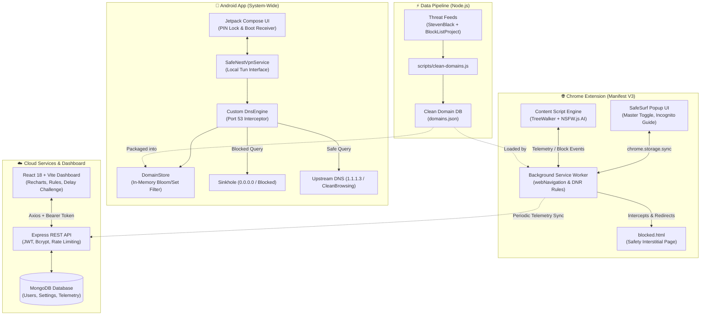

# 🛡️ SafeNest (SafeSurf)

> **Intelligent, Multi-Platform Content Protection & Digital Well-Being Suite**

[](https://developer.chrome.com/docs/extensions/mv3/intro/)
[-3DDC84?logo=android&logoColor=white)](https://developer.android.com/)
[](https://react.dev/)
[](https://nodejs.org/)
[](https://opensource.org/licenses/MIT)
[](https://github.com/Aditya717pro/SafeNest/pulls)

**SafeNest** (also known as **SafeSurf**) is an end-to-end digital safety and content protection ecosystem. Engineered for individuals, parents, and organizations, SafeNest delivers multi-layered shielding against adult content, explicit media, and profanity across both desktop web browsers and mobile devices—without compromising user privacy.

---

## 🌟 Key Highlights

- 🔒 **100% Privacy-Preserving**: On-device AI classification and local DNS filtering. Your browsing history, visited URLs, and screen content never leave your device.
- 🚀 **Multi-Platform Coverage**: Native Android DNS-level filtering (system-wide across all apps) paired with a high-performance Manifest V3 Chrome Extension.
- 🧠 **On-Device Computer Vision**: Bundled TensorFlow.js + NSFW.js models classify and blur explicit imagery in real time within the browser, strictly compliant with MV3 Content Security Policy (CSP).
- 🛑 **SafeSearch Enforcement**: Dynamic HTTP/DNS rewriting enforcing strict filtering on Google, Bing, DuckDuckGo, and YouTube Restricted Mode.
- 💬 **Multilingual Profanity Shield**: High-speed DOM scanning (`TreeWalker` + debounced `MutationObserver`) masking inappropriate terms in English, Hindi, Tamil, and Tanglish.
- 📊 **Telemetry & Analytics**: Comprehensive MERN stack backend and React + Tailwind dashboard with Recharts visualizations and anti-relapse challenge locks.

---

## 🏛️ System Architecture



---

## 🧩 Project Modules

### 1. 🌐 Chrome Extension (`/extension`)
Built on Google Chrome's **Manifest V3** standard for optimal performance and strict security:
- **Instant Domain Blocker**: In-memory `Set` containing 50,000+ threat-intelligence domains evaluated on `webNavigation.onBeforeNavigate`. Immediate redirect to a sleek, motivational interstitial (`blocked.html`).
- **On-Device NSFW AI**: Runs TensorFlow.js and NSFW.js directly in the content script context. Pre-filters small icons/avatars, evaluates visible images via `IntersectionObserver`, and applies a `28px` CSS blur to explicit content with click-unblur locks.
- **Dynamic SafeSearch Enforcer**: Utilizes `chrome.declarativeNetRequest` rules to force `safe=active` (Google), `adlt=strict` (Bing), `kp=1` (DuckDuckGo), and Restricted Mode headers (`YouTube`).
- **Profanity Masker**: Non-destructive DOM walker masking offensive words across single-page applications (YouTube comments, Twitter/X, Reddit).
- **Incognito Defense**: Detects whether incognito permissions are granted and guides the user through setup.

### 2. 📱 Android Application (`/android`)
Native Android application providing **OS-level, device-wide protection**:
- **Local DNS VPN Tunnel (`VpnService`)**: Intercepts UDP/TCP DNS queries on port 53. Requests never go to a remote VPN proxy—they are resolved locally on the device with zero added latency.
- **Smart DNS Sinkhole**: Blocks adult domains by returning loopback responses (`0.0.0.0`) while forwarding legitimate traffic to family-safe upstream resolvers (e.g., CleanBrowsing / Cloudflare Family `1.1.1.3`).
- **PIN Security (`PinManager`)**: Optional PIN lock preventing unauthorized or impulsive disabling of the protection service.
- **Auto-Boot Persistence**: Automatically restarts VPN protection upon system boot (`RECEIVE_BOOT_COMPLETED`).
- **Modern Jetpack Compose UI**: Clean, responsive Material 3 interface with real-time status indicators and debugging diagnostics.

### 3. ☁️ Backend Server (`/server`)
Robust REST API built on the MERN stack:
- **Authentication**: JWT token-based auth with salted passwords (`bcryptjs` 12 rounds).
- **Cross-Device Settings Sync**: Centralized configuration for custom whitelists, blacklists, sensitivity thresholds, and active shield state.
- **Telemetry Aggregation**: Stores hourly/daily counters for blocked domains, masked words, and blurred images.
- **Production Hardened**: Pre-configured with `helmet`, `cors`, and `express-rate-limit`.

### 4. 📊 Analytics Dashboard (`/dashboard`)
Single Page Application (SPA) designed with **React 18**, **Vite**, and **Tailwind CSS**:
- **Visual Analytics**: Interactive Recharts graphs displaying weekly shield activity, threat categories, and protection uptime.
- **Filter Rule Manager**: Effortlessly add or delete domain entries from your personal Whitelist and Blacklist.
- **Anti-Relapse Challenge Lock**: Enforces a customizable cooldown delay and randomized verification pledge typing challenge before protection can be toggled off.

### 5. ⚡ Threat Intelligence Pipeline (`/scripts`)
Automated data pipelines that ingest raw blocklists (StevenBlack hosts, BlockListProject):
- Strips comments, loopback IPs, IPV6 mappings, and regex artifacts.
- Canonicalizes hostnames, eliminates redundant subdomains, and compiles ultra-compact JSON dictionaries for zero-overhead runtime lookup.

---

## 📁 Repository Structure

```text
SafeNest/
├── android/                        # Android Local VPN Application
│   ├── app/
│   │   ├── src/main/java/com/safenest/app/
│   │   │   ├── boot/               # Boot-completed broadcast receiver
│   │   │   ├── data/               # App preferences & PIN manager
│   │   │   ├── ui/                 # Jetpack Compose UI (HomeScreen, Theme)
│   │   │   └── vpn/                # DNS engine, packet parser & VpnService
│   │   └── build.gradle.kts
│   └── build.gradle.kts
├── extension/                      # Chrome Extension (Manifest V3)
│   ├── manifest.json               # MV3 manifest specifications
│   ├── background.js               # Service Worker: Navigation & DNR router
│   ├── content.js                  # AI image classification & DOM text masking
│   ├── content.css                 # Media blur & overlay styling
│   ├── blocked.html                # Interstitial block page with quotes
│   ├── popup/                      # Extension popup UI & incognito checker
│   ├── libs/                       # Bundled TensorFlow.js & NSFW.js
│   ├── models/                     # Offline AI model weights
│   └── data/                       # Pre-compiled domain & profanity lists
├── server/                         # Express / Node.js Backend API
│   ├── config/                     # Database connection logic
│   ├── middleware/                 # Auth verification & rate limiters
│   ├── models/                     # Mongoose models (User, Settings, BlockStats)
│   ├── routes/                     # API routes (Auth, Settings, Stats)
│   ├── index.js                    # Express application entrypoint
│   └── .env.example                # Sample environment configuration
├── dashboard/                      # React + Vite Admin Dashboard
│   ├── src/                        # React source (Pages, Components, Services)
│   ├── tailwind.config.js          # Tailwind CSS styling tokens
│   ├── vite.config.js              # Vite configuration
│   └── package.json
├── scripts/                        # Data collection and cleanup scripts
│   ├── clean-domains.js            # Host list deduplication & compilation
│   └── build-blocklist.js          # Fast blocklist builder
├── PLAN.md                         # Detailed engineering architecture plan
└── README.md                       # Project documentation
```

---

## 🚀 Getting Started

### Prerequisites

Ensure you have the following installed on your development machine:
- **Node.js**: v18.0.0 or higher ([Download](https://nodejs.org/))
- **npm**: v9.0.0 or higher
- **Android Studio / SDK**: Android SDK 34, Min SDK 26 (Android 8.0+)
- **MongoDB**: Local MongoDB instance or [MongoDB Atlas](https://www.mongodb.com/atlas) cluster
- **Google Chrome**: v102+ (for Manifest V3 declarativeNetRequest support)

---

### 1. Setting Up the Chrome Extension

1. Open Google Chrome and navigate to `chrome://extensions/`.
2. Toggle on **Developer mode** in the top-right corner.
3. Click **Load unpacked** in the top-left corner.
4. Select the `extension/` folder in this repository:
   ```text
   SafeNest/extension
   ```
5. Click on the extension's **Details** button, scroll down, and enable **"Allow in Incognito"** to ensure continuous protection during private browsing sessions.

---

### 2. Building & Running the Android App

1. Open Android Studio and select **Open**, then choose the `android/` directory.
2. Allow Gradle to synchronize dependencies.
3. To compile and run via the command line:
   ```bash
   cd android
   # On Windows (PowerShell):
   .\gradlew.bat assembleDebug

   # On macOS/Linux:
   ./gradlew assembleDebug
   ```
4. Install the generated APK onto your connected device or emulator:
   ```bash
   adb install -r app/build/outputs/apk/debug/app-debug.apk
   ```
5. Launch **SafeNest**, grant the VPN configuration prompt, and tap **Start Protection**.

---

### 3. Setting Up the Backend Server

1. Navigate to the `server/` directory:
   ```bash
   cd server
   ```
2. Install dependencies:
   ```bash
   npm install
   ```
3. Create your `.env` configuration file:
   ```bash
   cp .env.example .env
   ```
   Configure the following variables in `.env`:
   ```env
   PORT=5000
   MONGO_URI=mongodb://localhost:27017/safesurf
   JWT_SECRET=your_super_secret_jwt_key_here
   CLIENT_URL=http://localhost:5173
   ```
4. Start the server:
   ```bash
   # Development mode with auto-reload:
   npm run dev

   # Production mode:
   npm start
   ```
   The backend API will run at `http://localhost:5000`.

---

### 4. Running the React Dashboard

1. Navigate to the `dashboard/` directory:
   ```bash
   cd dashboard
   ```
2. Install dependencies:
   ```bash
   npm install
   ```
3. Start the Vite development server:
   ```bash
   npm run dev
   ```
4. Open `http://localhost:5173` in your browser. Register an account and view the telemetry analytics!

---

### 5. Updating Domain Blocklists

To refresh the local domain blacklist database from upstream threat feeds:
```bash
node scripts/clean-domains.js
```
The script will download, sanitize, deduplicate, and compile host records into `extension/data/domains.json`.

---

## 🔒 Security & Privacy Principles

| Area | Implementation |
| :--- | :--- |
| **No Remote Image Analysis** | Computer vision image classification takes place entirely on-device using local WebGL/WASM TensorFlow runtimes. No images or media ever traverse the network. |
| **Zero VPN Logging** | The Android VPN runs as a local loopback DNS sinkhole. SafeNest does not operate external proxy nodes or inspect data payloads. |
| **Tamper Resistance** | Optional PIN security on mobile, combined with typing verification challenges and cooldown delay locks on the web dashboard to prevent impulsive relapses. |
| **Password Security** | Passwords salted and hashed with 12 bcrypt rounds. API communication guarded by short-lived JWT tokens and rate limiting. |

---

## 🛠️ Tech Stack

- **Extension**: Vanilla JavaScript (ES Modules), Chrome Manifest V3 APIs (`webNavigation`, `declarativeNetRequest`, `storage.sync`), TensorFlow.js, NSFW.js.
- **Android**: Kotlin, Jetpack Compose, Material 3, Android `VpnService`, Coroutines, StateFlow.
- **Backend**: Node.js, Express, MongoDB, Mongoose, JSON Web Tokens (JWT), Bcrypt, Helmet, CORS.
- **Frontend**: React 18, Vite, Tailwind CSS, Recharts, Lucide Icons, Axios.
- **Tooling & Data**: Node.js stream processing, Python icon generator.

---

## 🤝 Contributing

Contributions are welcomed! Whether you want to improve classification models, add additional language dictionaries, or optimize the Android DNS packet parser:

1. **Fork** the repository.
2. **Create a Feature Branch**: `git checkout -b feature/amazing-feature`
3. **Commit Your Changes**: `git commit -m 'feat: Add amazing feature'`
4. **Push to the Branch**: `git push origin feature/amazing-feature`
5. **Open a Pull Request**.

---

## 📄 License

This project is licensed under the **MIT License** - see the [LICENSE](LICENSE) file for details.

---

<p align="center">
  <b>Built with ❤️ for a safer, healthier digital environment.</b>
</p>
